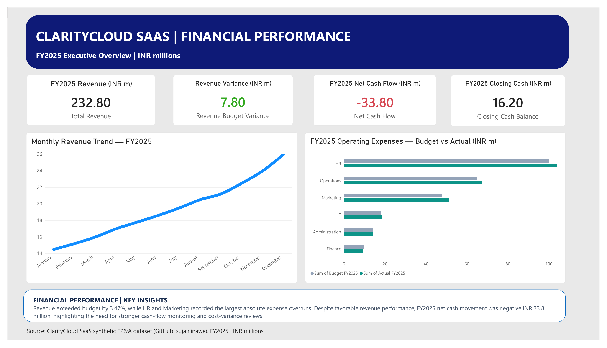
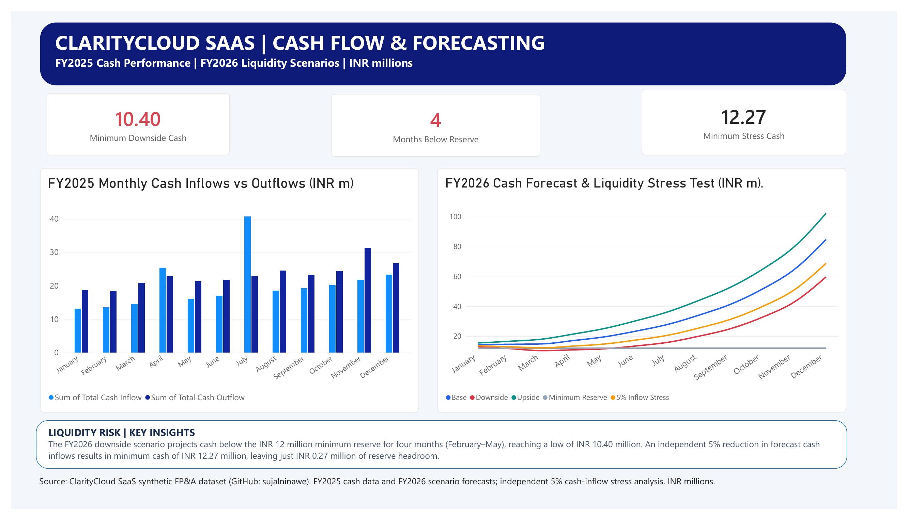
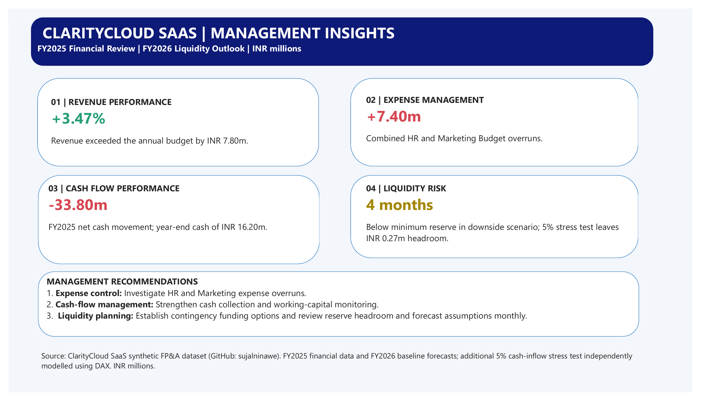

# ClarityCloud SaaS | Financial Performance & Liquidity Analytics

**Financial Analyst / FP&A portfolio project**  
**Tools:** Power BI Desktop, Power Query, DAX, Microsoft Excel  
**Period:** FY2025 performance, FY2026 scenarios  
**Currency:** INR millions  
**Data:** Synthetic / fictional company; not real corporate financial records

## Explore the dashboard

[View the three-page financial analytics report (PDF)](ClarityCloud_Financial_Analytics.pdf)

### Page 1: Financial Performance



### Page 2: Cash Flow & Forecasting



### Page 3: Management Insights



## Business question

How is the fictional SaaS company performing against budget, why is its cash position under pressure despite revenue growth, and how resilient are projected cash balances to a shortfall in inflows?

## Key findings

| Indicator | Result | Interpretation |
|---|---:|---|
| FY2025 revenue | INR 232.80m | INR 7.80m (3.47%) above budget |
| HR and Marketing combined expense variance | +INR 7.40m | Expense overruns warrant investigation |
| FY2025 net cash movement | -INR 33.80m | Overall cash declined during the year |
| FY2025 closing cash | INR 16.20m | Opening balance used for the 2026 stress scenario |
| Minimum downside cash, FY2026 | INR 10.40m | Below the INR 12m reserve floor |
| Downside months below reserve | 4 | February through May 2026 |
| Minimum cash under independent 5% inflow stress | INR 12.27m | INR 0.27m of minimum reserve headroom |

## Analysis and tools

- **Power Query:** Imported and corrected date data types in the source transactions and reporting tables; validated monthly financial fields.
- **DAX measures:** Built revenue, revenue budget variance, net cash flow, last-period closing cash, minimum downside cash, months below reserve and sensitivity-model measures.
- **Reporting design:** Produced two analytical pages and a management-summary page with financial KPIs, expense comparisons, monthly cash movements and scenario forecasts.
- **Management interpretation:** Highlighted cost variances, cash conversion risks and the need for ongoing liquidity monitoring.

### Independent sensitivity analysis

An additional scenario reduces **each month's base-case forecast cash inflow by 5%** while holding base forecast outflows unchanged. It starts with FY2025 closing cash of **INR 16.20m** and accumulates the adjusted net monthly movements:

```text
Stress closing cash at month t
= 16.20 + cumulative SUM through month t of
  (0.95 × base cash inflow − base cash outflow)
```

The lowest projected closing cash is **INR 12.27m**, compared with the synthetic company's minimum cash reserve requirement of **INR 12.00m**. This is a separately constructed sensitivity scenario, not an actual financial outcome or a claim of statistical forecast accuracy.

## Management recommendations

1. Review HR and Marketing expense overruns with cost-centre owners; determine which variances are controllable and which are growth-related.
2. Monitor collections and the timing difference between recognized revenue and cash inflows; refresh monthly cash forecasts.
3. Prepare contingency liquidity options and monitor monthly reserve headroom against a documented minimum cash threshold.

## Source and authorship

**Upstream dataset and pre-existing model:** [Cash Flow Forecasting & Budgeting Model by sujalninawe](https://github.com/sujalninawe/cash-flow-forecasting-budgeting-model). The upstream project provides synthetic ClarityCloud transactions, planning tables, budget-versus-actual figures and initial cash-flow/scenario modelling.

**Portfolio work:** The Power BI data-type corrections, DAX calculations, report design, management presentation and separately modelled 5% cash-inflow stress test are presented here as work carried out for this portfolio. This repository does **not** claim that the underlying fictional company or pre-existing dataset was created by the portfolio author.

The upstream repository did not display an explicit redistribution license when reviewed. Its original data and workbook are therefore **not bundled here**; refer to the source link for those files. The PDF and screenshots in this repository are outputs of the Power BI portfolio report.

## Reproducibility and limitations

- Results relate to **fictional, illustrative** financial data, not company audited financial statements.
- This is a reporting and sensitivity-analysis exercise; it does not establish professional P&L ownership or forecast outcomes at a real business.
- The PDF contains static visuals. An interactive `.pbix` file is not included in this package, because only the exported PDF was provided for publication preparation.
- If a Power BI report file is added later, any redistribution of embedded upstream data should first be checked against the upstream owner's permission or licensing terms.
